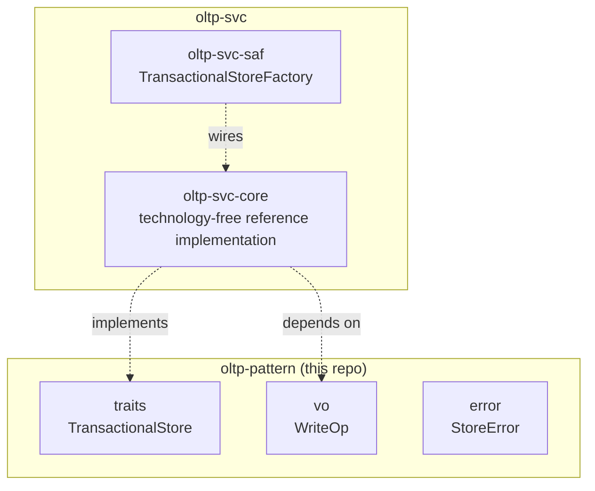

# oltp-pattern Architecture

**Audience**: Architects, technical leads, contributors.

## Overview

One crate, `oltp-pattern` — this domain's primitives, zero implementation,
zero knowledge of any specific OLTP backend:

- **`traits/`** — `TransactionalStore` (`type Key`/`type Record` associated
  types, `get(key)`, `put(key, record)`, `delete(key)`, `write_batch(ops)`).
  Generic over its own key/record types via associated types — not a fixed
  opaque-bytes payload; see "Why `TransactionalStore` is generic over
  `Key`/`Record`" below.
- **`vo/`** — `WriteOp<K, R>` (`Put(K, R)` / `Delete(K)` — one op in an
  atomic batch, generic over the same `Key`/`Record` types).
- **`error/`** — `StoreError` (`NotFound`, `WriteFailed`,
  `TransactionFailed`, `ConnectionFailed`).

Everything that would make this crate aware of a specific OLTP technology —
an in-process table, a real transactional database — lives in
[`oltp-svc`](https://github.com/sweengineeringlabs/oltp-svc) instead.

## Component Diagram

## Why `TransactionalStore` has only get/put/delete/write_batch

See [ADR-001](adr/ADR-001-contract-first-domain-design.md). OLTP workloads
are defined by fast, strongly-consistent operations on individual records
(or a small number of them, atomically) — not by declarative queries over
the whole dataset. Four operations cover that domain completely: point read
(`get`), point upsert (`put`), point delete (`delete`), and atomic multi-key
write (`write_batch`, for the "move money between two accounts" class of
operation that a single-key op can't express). Secondary indexes, range
scans, and a query language are a different domain — see this repo's
sibling, `olap-pattern`.

## Why `TransactionalStore` is generic over `Key`/`Record`

Until `oltp-pattern` v0.2.0, `TransactionalStore` was addressed by a fixed
`RecordKey` (an opaque string wrapper) and held a fixed `Record` (an opaque
`Vec<u8>` payload) — mirroring `message-broker-pattern::Message`'s shape.
Raised as a real, checked zero-cost abstraction question in
[oltp-pattern#5](https://github.com/sweengineeringlabs/oltp-pattern/issues/5):
`Message` genuinely needs to be opaque bytes, because `MessageBroker`
crosses real network boundaries (NATS/Kafka/Postgres) where something has
to be serialized onto the wire regardless. `oltp-svc`'s only backend
(`InMemoryTransactionalStore`) is purely in-process — there is no network
boundary here at all, so forcing every caller through `Vec<u8>` bought
nothing but an avoidable serialize/deserialize round trip.

This org's own real prior art for this exact domain,
`edge-application-repository-api`'s `Repository` trait (`type Entity`/
`type Id` associated types, monomorphized per concrete implementation —
found only after this crate first shipped without checking for it), does
not make that mistake. `TransactionalStore` now follows that shape:
`type Key`/`type Record` are associated types, and `get`/`put`/`delete`/
`write_batch` are generic over whatever concrete types an implementation
names. A caller using an in-process backend pays zero serialization cost;
a caller whose backend genuinely needs bytes on the wire can still pick
`Vec<u8>` as its own `Record` type — nothing is lost, only the forced case
is removed.

This also removes the per-call boxed future (`StoreFuture`, a
`Pin<Box<dyn Future>>` wrapper) in favor of `impl Future` (RPITIT, stable
since 1.75) — no heap allocation, no vtable dispatch — at a real, accepted
cost: `TransactionalStore` is no longer object-safe (associated types plus
RPITIT rule out `Box<dyn TransactionalStore>`). `oltp-svc`'s factory
resolves the consequence with a generic function
(`TransactionalStoreFactory::in_memory::<K, R>()`) rather than a uniform
boxed return type — see that repo's own architecture doc.

`StoreError::NotFound` stays a plain `String`, not a generic `Self::Key` --
see that variant's own doc comment in `error/store_error.rs` for why
(no real caller constructs it today; making the whole error type generic
for an unused variant was judged disproportionate).

## Why `write_batch` takes `Vec<WriteOp>`, not separate multi-put/multi-delete methods

A single method taking a mixed sequence of `Put`/`Delete` ops (rather than
`put_many`/`delete_many` as two separate calls) is what makes the batch
atomic across mixed operation types in one round trip — "delete the old
record and insert two new ones" is one real transaction, not two
sequential calls that could partially fail between them.

## Why no `Validator` trait (yet)

`message-broker-pattern` and `executor-pattern` both declare a `Validator`
trait for their respective `-svc`-side backend config types to implement.
`oltp-pattern` declares none — there is no backend config type yet to
validate (`oltp-svc` starts with `core` only, which needs no runtime
parameters). Adding `Validator` before a real config type exists to
validate would be speculative machinery with nothing to attach it to —
same reasoning `scheduler-pattern` used for the same omission; see that
crate's own architecture.md.

## Scope boundary

This repo covers exactly `TransactionalStore` (single-key point CRUD plus
atomic multi-key batch writes). Not covered:

- **Secondary indexes / range scans** — a `TransactionalStore` is
  addressed strictly by key; listing/scanning records by anything other
  than an exact key is a materially larger feature (index maintenance,
  query planning) that no real consumer has needed yet.
- **Optimistic concurrency / versioned writes (compare-and-swap)** — real
  and useful, but additive: a `put_if_version(key, record, expected_version)`
  method can be added later without breaking this contract. Deferred until
  a real consumer needs it.
- **TTL / expiring records** — same reasoning; additive, deferred.
- **Declarative queries over the whole dataset** — already
  `olap-pattern`'s `AnalyticalStore`. `oltp-svc`'s own implementations may
  well be backed by a database that also supports analytical queries, but
  that's an implementation detail of `-svc`, not part of this contract.
- **Distributed task queues** (enqueue work, workers pick it up
  immediately, no key-addressed read/write) — already
  `task-queue-pattern`'s `TaskQueue`.

[← Docs index](../README.md)
