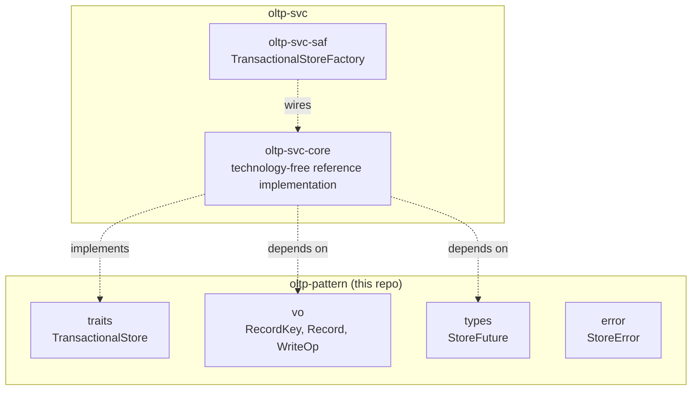

# oltp-pattern Architecture

**Audience**: Architects, technical leads, contributors.

## Overview

One crate, `oltp-pattern` — this domain's primitives, zero implementation,
zero knowledge of any specific OLTP backend:

- **`traits/`** — `TransactionalStore` (`get(key)`, `put(key, record)`,
  `delete(key)`, `write_batch(ops)`).
- **`vo/`** — `RecordKey` (opaque string-based key), `Record` (opaque byte
  payload), `WriteOp` (`Put(RecordKey, Record)` / `Delete(RecordKey)` — one
  op in an atomic batch).
- **`types/`** — `StoreFuture` (local boxed-future wrapper, same shape as
  `message-broker-pattern::BrokerFuture`).
- **`error/`** — `StoreError` (`NotFound`, `WriteFailed`,
  `TransactionFailed`, `ConnectionFailed`).

Everything that would make this crate aware of a specific OLTP technology —
an in-process table, a real transactional database — lives in
[`oltp-svc`](https://github.com/sweengineeringlabs/oltp-svc) instead.

## Component Diagram

## Why `TransactionalStore` has only get/put/delete/write_batch

See [ADR-001](adr/ADR-001-contract-first-domain-design.md). OLTP workloads
are defined by fast, strongly-consistent operations on individual records
(or a small number of them, atomically) — not by declarative queries over
the whole dataset. Four operations cover that domain completely: point read
(`get`), point upsert (`put`), point delete (`delete`), and atomic multi-key
write (`write_batch`, for the "move money between two accounts" class of
operation that a single-key op can't express). Secondary indexes, range
scans, and a query language are a different domain — see this repo's
sibling, `olap-pattern`.

## Why `Record` carries only raw bytes

Mirrors `message-broker-pattern::Message`: no schema, no column types, no
serialization format baked into the contract. A `Record` is exactly as
opaque as the caller needs it to be (JSON, protobuf, anything) — this
crate has zero opinion. A structured, typed row with named columns is the
`olap-pattern::Row`/`ColumnValue` shape instead, because analytical
consumers genuinely need to inspect and operate on individual column
values (aggregate, filter, project); a transactional consumer addressing a
record by key does not.

## Why `write_batch` takes `Vec<WriteOp>`, not separate multi-put/multi-delete methods

A single method taking a mixed sequence of `Put`/`Delete` ops (rather than
`put_many`/`delete_many` as two separate calls) is what makes the batch
atomic across mixed operation types in one round trip — "delete the old
record and insert two new ones" is one real transaction, not two
sequential calls that could partially fail between them.

## Why no `Validator` trait (yet)

`message-broker-pattern` and `executor-pattern` both declare a `Validator`
trait for their respective `-svc`-side backend config types to implement.
`oltp-pattern` declares none — there is no backend config type yet to
validate (`oltp-svc` starts with `core` only, which needs no runtime
parameters). Adding `Validator` before a real config type exists to
validate would be speculative machinery with nothing to attach it to —
same reasoning `scheduler-pattern` used for the same omission; see that
crate's own architecture.md.

## Scope boundary

This repo covers exactly `TransactionalStore` (single-key point CRUD plus
atomic multi-key batch writes). Not covered, deliberately:

- **Secondary indexes / range scans** — a `TransactionalStore` is
  addressed strictly by key; listing/scanning records by anything other
  than an exact key is a materially larger feature (index maintenance,
  query planning) that no real consumer has needed yet.
- **Optimistic concurrency / versioned writes (compare-and-swap)** — real
  and useful, but additive: a `put_if_version(key, record, expected_version)`
  method can be added later without breaking this contract. Deferred until
  a real consumer needs it.
- **TTL / expiring records** — same reasoning; additive, deferred.
- **Declarative queries over the whole dataset** — already
  `olap-pattern`'s `AnalyticalStore`. `oltp-svc`'s own implementations may
  well be backed by a database that also supports analytical queries, but
  that's an implementation detail of `-svc`, not part of this contract.
- **Distributed task queues** (enqueue work, workers pick it up
  immediately, no key-addressed read/write) — already
  `task-queue-pattern`'s `TaskQueue`.

[← Docs index](../README.md)
